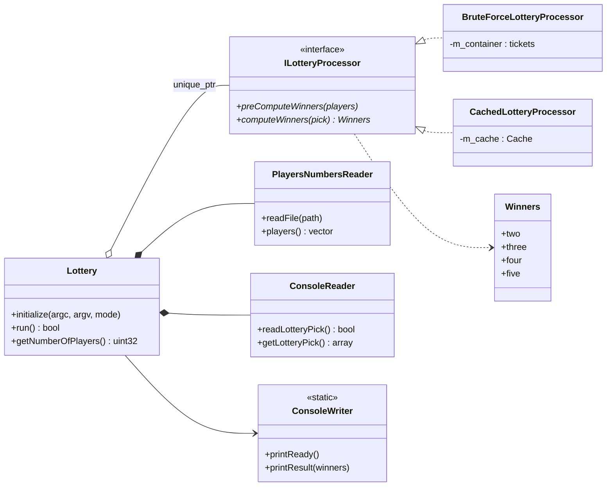
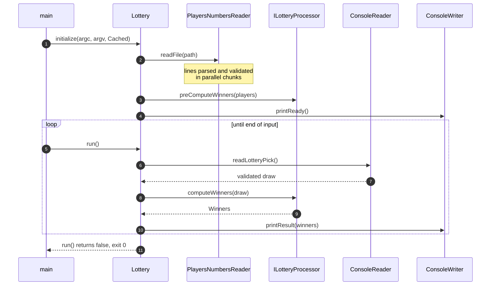
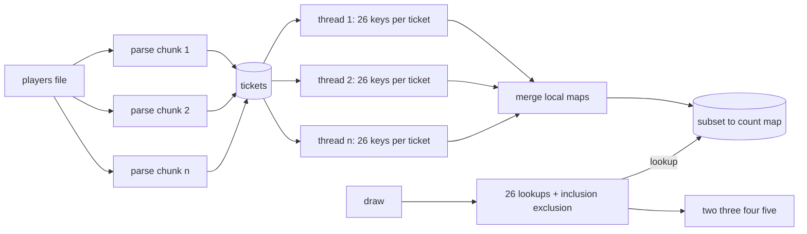

# Hungarian Lottery

**Answers a lottery draw over 10 million tickets in half a microsecond (median latency).**

A C++17 engine for the Hungarian lottery model that trades a one time preprocessing pass for constant time answers per draw, built with interchangeable strategies, strict input validation and a fully automated quality pipeline.

[](https://github.com/renanleonellocastro/hungarian_lottery/actions/workflows/ci.yml)
[](https://renanleonellocastro.github.io/hungarian_lottery/coverage/)
[](https://github.com/renanleonellocastro/hungarian_lottery/actions/workflows/codeql.yml)
[](https://renanleonellocastro.github.io/hungarian_lottery/)


[](LICENSE)

---

## Contents

* [The problem](#the-problem)
* [Quick start](#quick-start)
* [Usage](#usage)
* [Architecture](#architecture)
* [The cached strategy](#the-cached-strategy)
* [Performance](#performance)
* [Testing and quality](#testing-and-quality)
* [Design notes](#design-notes)
* [Project structure](#project-structure)
* [Roadmap](#roadmap)
* [License](#license)

## The problem

This project is a coding exercise built around the Hungarian lottery model, known as **Ötöslottó**:

* every player picks **5 distinct numbers from 1 to 90**;
* the lottery draws 5 numbers;
* for each draw, report **how many players matched exactly 2, 3, 4 and 5 numbers**.

The players are loaded once from a file, which can hold millions of tickets. Draws then arrive one by one on standard input and each one must be answered as fast as possible.

## Quick start

### Docker (no local toolchain needed)

```bash
git clone https://github.com/renanleonellocastro/hungarian_lottery.git && cd hungarian_lottery
docker build -t hungarian-lottery . && docker run --rm -it hungarian-lottery
```

The image build compiles the project and runs the whole test suite. The container then generates 1,000,000 players and waits for draws: type five numbers and press Enter, or Ctrl+D to quit. To use your own file, mount it: `docker run --rm -i -v "$PWD:/data" hungarian-lottery /data/players.txt`.

### Native build (Ubuntu 24.04)

```bash
sudo apt-get install -y g++ cmake ninja-build pkg-config python3 libgtest-dev libgoogle-glog-dev
./build.sh                       # Release build: application, tests and benchmark tool
./run_unit_tests.sh              # 52 unit tests
./run_integration_tests.sh       # end to end tests on generated datasets
```

Optional tools: `gcovr` (coverage), `valgrind`, `doxygen` and `graphviz` (API documentation).

## Usage

```text
lottery <players_file>
```

* `players_file`: one ticket per line, five distinct integers from 1 to 90 separated by whitespace.
* After loading and preprocessing, the program prints `READY`.
* Each line on stdin is a draw. For each draw it prints `<two> <three> <four> <five>`: the number of players with exactly 2, 3, 4 and 5 matches.
* It exits with status `0` at end of input, and with status `1` and an error log on invalid arguments or input.

Generate a reproducible dataset and pipe draws from a file:

```bash
python3 tools/generate_players.py --players 1000000 --draws 4 --seed 42 --out-dir /tmp/lottery
./build/lottery /tmp/lottery/players.txt < /tmp/lottery/draws.txt
```

```text
READY
22504 801 4 0
22124 805 9 1
22623 844 9 0
22491 850 9 1
```

`/tmp/lottery/expected.txt` holds the same four lines, computed independently by the generator.

## Architecture

`main` only configures logging and drives the loop. `Lottery` orchestrates input, preprocessing and output, and delegates the counting to a strategy behind the `ILotteryProcessor` interface. IO, validation and algorithms live in separate classes, so a new strategy is one new class and one new enum value.





| Class | Responsibility |
|-------|----------------|
| `Lottery` | Application flow: arguments, loading, preprocessing, draw loop |
| `ILotteryProcessor` | Strategy interface: preprocess once, answer many draws |
| `BruteForceLotteryProcessor` | Reference strategy, scans every ticket per draw |
| `CachedLotteryProcessor` | Precomputes subset counts, answers in constant time |
| `PlayersNumbersReader` | Reads and validates the players file on all cores |
| `ConsoleReader` / `ConsoleWriter` | Validated draw input and result output |

## The cached strategy

A ticket matches a draw in exactly `m` numbers when they share `m` numbers. Instead of comparing tickets to the draw, the cached strategy counts, ahead of time, **how many tickets contain each possible subset of 2, 3, 4 and 5 numbers**.

**Preprocessing.** Every ticket has C(5,2) + C(5,3) + C(5,4) + C(5,5) = 10 + 10 + 5 + 1 = **26 subsets**. Each subset is sorted and packed into a 64 bit key (one byte per number, left padded with zeros so subsets of different sizes never collide), and its counter is incremented. The players are split into one chunk per hardware thread, each thread fills a private hash map, and the maps are merged at the end, so no locks are taken on the hot path.

**Answering a draw.** Look up the 26 subsets of the draw and sum the counts per size into `S5, S4, S3, S2`. A ticket with exactly `m` matches contains C(m,k) of the draw's k subsets, so it is counted several times in the smaller sums. Inclusion and exclusion removes the overlap, from the largest size down:

```text
five  = S5
four  = S4 - 5·five
three = S3 - 4·four - 10·five
two   = S2 - 3·three - 6·four - 10·five
```



| | Brute force | Cached |
|---|---|---|
| Preprocessing | O(N), copies the tickets | O(26·N), parallel over all cores |
| Per draw | O(5·N) comparisons | **O(1)**: 26 hash lookups, independent of N |
| Memory | 5 bytes per ticket | One entry per distinct subset, bounded by C(90,2) + C(90,3) + C(90,4) + C(90,5) ≈ 46.6M |

The brute force strategy stays in the code base as the reference implementation that the cached strategy is tested against.

## Performance

Measured with `./run_benchmark.sh` (seeded datasets, 20 draws, 5 repetitions per draw, so 100 samples per row). Load time is reading and validating the file; preprocess is `preComputeWinners`.

**Environment:** Docker Desktop Linux VM (Ubuntu 24.04, aarch64, 18 vCPUs, 7.7 GiB RAM) on an Apple M5 Pro; GCC 13.3, Release build with `-O3 -march=native` and LTO.

| Strategy | Players | Load (ms) | Preprocess (ms) | Draw p50 (µs) | Draw p99 (µs) | Draw max (µs) |
|---|---:|---:|---:|---:|---:|---:|
| BruteForce | 1,000,000 | 34.8 | 0.7 | 4,178.3 | 4,788.6 | 4,858.1 |
| Cached | 1,000,000 | 34.8 | 1,151.7 | **0.2** | 5.0 | 6.3 |
| BruteForce | 10,000,000 | 329.6 | 1.5 | 41,770.5 | 45,373.8 | 46,019.3 |
| Cached | 10,000,000 | 329.6 | 8,218.7 | **0.5** | 5.6 | 16.9 |

* The cached strategy answers a draw about **80,000 times faster** than the brute force scan at 10M players, and its latency does not grow with the number of players.
* The price is paid once: about 8.2 s of parallel preprocessing for 10M tickets. Peak RSS of the benchmark process, holding both strategies, was 0.85 GB at 1M and 2.6 GB at 10M players.
* Numbers from the CI runners are attached to every run as a job summary (200k players).

Reproduce: `./run_benchmark.sh 1000000 10000000`.

## Testing and quality

| Layer | What runs | Where |
|-------|-----------|-------|
| Unit tests | 52 GoogleTest cases: parsing and validation, both processors, combination generation, key encoding, threading edge cases, the `Lottery` flow | `ctest -L unit` |
| Integration tests | Both strategies on a 1k and a 200k player dataset, compared line by line with an independent Python oracle; black box tests of the executable, including exit statuses | `ctest -L integration` |
| Compilers | GCC and Clang, Release and Debug, `-Wall -Wextra -Wpedantic -Werror` | CI matrix |
| Sanitizers | AddressSanitizer + UndefinedBehaviorSanitizer (leak detection on) | CI |
| Memory | Valgrind memcheck of the executable, failing on any error or definite leak | CI |
| Coverage | gcovr line, function and branch coverage, published as an HTML report and a live badge | CI + Pages |
| Static analysis | CodeQL security and quality queries | CI, weekly |
| Benchmark | `lottery_benchmark` also fails if the strategies disagree on any draw | CI smoke run |

Test datasets are generated at build time by `tools/generate_players.py`: same seed, same files. Half of the draws are copies of existing tickets, some with one number swapped, so every match category is exercised even on small inputs.

Locally: `./run_coverage.sh` writes `coverage/index.html`, and `./generate_full_documentation.sh` writes the Doxygen site to `docs/html`.

## Design notes

### Input validation

Every input is validated, from the players file and from stdin alike:

* exactly 5 numbers per line, neither more nor fewer;
* every number between 1 and 90;
* no duplicate numbers within a ticket or draw;
* only integers and whitespace: letters, commas or trailing garbage are rejected;
* empty lines in the players file are skipped; Windows line endings are accepted.

Invalid input is logged through glog (with the line number for the players file) and stops the program with a non zero exit status. Failing fast was preferred over skipping bad tickets: silently dropping a ticket would change the winner counts without anyone noticing.

### Why two strategies

The strategy interface keeps the choice of algorithm out of the application flow. The brute force processor is short enough to be obviously correct, which makes it the oracle for the cached one in unit tests and in the benchmark tool. The application uses the cached strategy, since the workload is one preprocessing pass followed by many latency sensitive draws.

### Parallelism

Both the file parsing and the cache construction split the work into one contiguous chunk per hardware thread with `std::async`. Each task owns its output (a vector of tickets or a private hash map), so there is no shared mutable state until the single threaded merge, and the result is deterministic regardless of scheduling.

### Ideas to scale further

* **Dense indexing instead of hashing.** The combinatorial number system maps every k subset of 1..90 to a unique index in `[0, C(90,k))`. Flat counter arrays (about 47M `uint32_t`, roughly 190 MB) would replace the hash map, remove the per node allocations and turn every lookup into one array read.
* **Lower memory strategies.** For environments where preprocessing time or memory is the constraint, a bitset index per number (90 bitsets of N bits, intersected with SIMD popcounts) answers a draw in O(N/64) with about 1.1 GB for 100M players.
* **Hardware awareness.** NUMA aware allocation to keep each thread's data on its node, thread pinning to avoid migrations and cache invalidation, and huge pages for the large tables.

## Project structure

```text
hungarian_lottery/
├── include/                  public headers (one class per header)
├── src/                      implementation and main.cpp
├── tests/
│   ├── unit/                 GoogleTest unit tests
│   └── integration/          end to end tests and the CLI black box test
├── benchmarks/               lottery_benchmark tool
├── tools/
│   ├── generate_players.py   seeded dataset generator and test oracle
│   ├── coverage_badge.py     gcovr summary to shields.io endpoint
│   └── docker-entrypoint.sh  container demo entrypoint
├── cmake/ProjectOptions.cmake  warnings, LTO, native tuning, coverage, sanitizers
├── docs/mainpage.md          Doxygen landing page
├── .github/workflows/        ci, docs (Pages), codeql, release
├── Dockerfile                multi stage build: test, then slim runtime
└── *.sh                      build, test, coverage, benchmark and docs helpers
```

### CMake options

| Option | Default | Effect |
|--------|---------|--------|
| `BUILD_TESTS` | `ON` | Unit and integration tests (needs GoogleTest and Python 3) |
| `BUILD_BENCHMARKS` | `ON` | `lottery_benchmark` |
| `ENABLE_NATIVE_ARCH` | `ON` | `-march=native` in Release; turned off for Docker and release binaries |
| `ENABLE_LTO` | `ON` | Link time optimization in Release when supported |
| `ENABLE_SANITIZERS` | `OFF` | ASan + UBSan |
| `ENABLE_COVERAGE` | `OFF` | gcov instrumentation |
| `WARNINGS_AS_ERRORS` | `OFF` | `-Werror` (on in CI) |

## Documentation

The API reference (Doxygen with class, call and include graphs) and the coverage report are published on every push to `main`:
**https://renanleonellocastro.github.io/hungarian_lottery/**

## Roadmap

* [ ] Select the strategy from the command line (the application currently always uses the cached one).
* [ ] Dense combinatorial indexing for the cached strategy (see [Ideas to scale further](#ideas-to-scale-further)).
* [ ] Bitset strategy for memory constrained environments.
* [ ] Memory mapped parsing of the players file to cut load time and peak memory.
* [ ] macOS build in CI.

## License

Released under the [MIT License](LICENSE).
