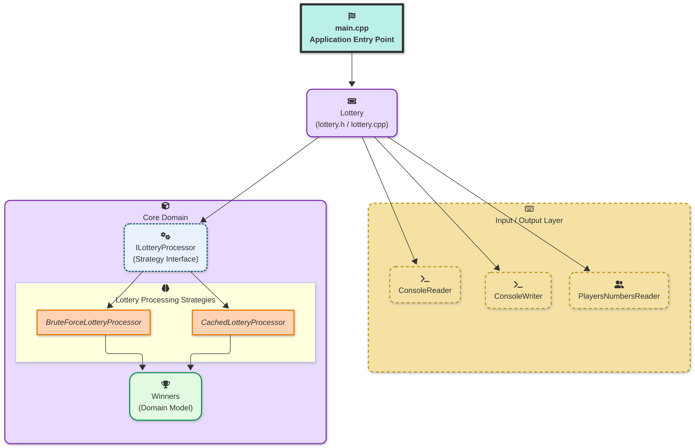
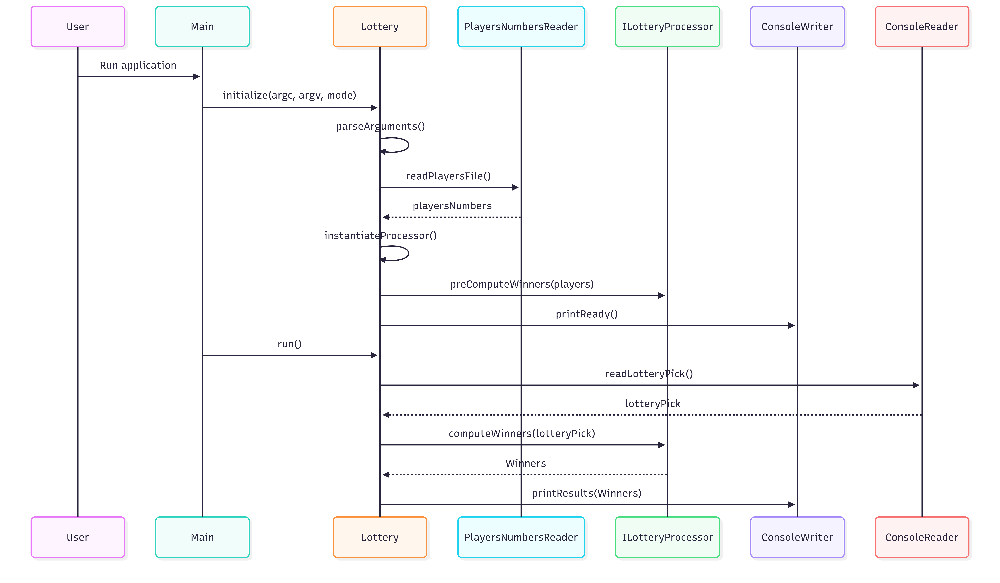
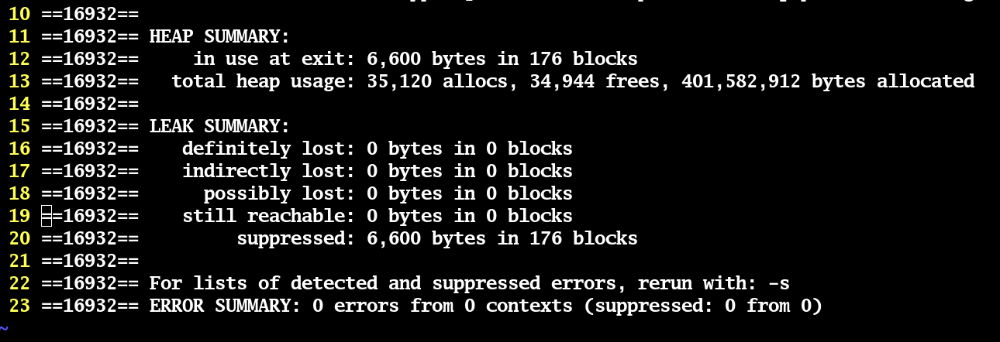

# 🎯 Hungarian Lottery - High-Performance C++ Lottery Processor


A **modern C++ lottery processing engine**, designed with **clean architecture**, **algorithmic clarity**, and **performance awareness**.

This project was implemented focusing on correctness, extensibility, testability, and efficiency rather than unnecessary complexity.

---

## 📌 Introduction

The **Hungarian Lottery** project reads a large set of lottery players' numbers from a file, accepts a lottery draw from standard input, and efficiently determines the winning players.

The design emphasizes:

* clear separation of concerns
* interchangeable processing strategies
* robust input validation
* deterministic, testable execution

Two different processing strategies were implemented:

* a **brute-force reference solution**
* a **cached strategy** optimized for faster winner lookups

---

## 📦 Dependencies

The project has **explicit and intentional dependencies**, chosen for correctness, testing, and observability.

### Required

* **C++17 compatible compiler**

  * `gcc >= 9` or `clang >= 10`
* `cmake`
* `make`
* `gtest` (unit tests)
* `glog` (logging)

### Optional

* **valgrind** (memory analysis)
* **doxygen + graphviz** (documentation)

---

### Debian / Ubuntu

```bash
sudo apt update
sudo apt install -y \
  build-essential \
  cmake \
  libgtest-dev \
  libgoogle-glog-dev \
  valgrind \
  doxygen \
  graphviz
```

### RHEL / CentOS / Rocky Linux

```bash
sudo dnf install -y \
  gcc-c++ \
  cmake \
  gtest-devel \
  glog-devel \
  valgrind \
  doxygen \
  graphviz
```

---

## ▶️ Demo

### Build

```bash
./build.sh
```

### Run

```bash
./run_lottery.sh tests/data/sample_input_file_1.txt
```

> ⚠️ **Sample datasets removed (2026-08-26).** The 200 files under `tests/data/`
> (`sample_input_file_{1..100}.txt` / `sample_expected_{1..100}.txt`, ~14.8 GB tracked
> with Git LFS) were purged from this repository to free the account's LFS quota.
> To run the demo or the integration tests, place your own players file(s) and expected
> outputs under `tests/data/` using those names (format: one player per line, five
> space-separated numbers in the range 1–90).

### Runtime Interaction

The application expects the **lottery draw to be provided via stdin, after the "READY" string is shown**:

```text
READY
1 2 3 4 5 -> user entry
```

### Example Execution

```text
./run_lottery.sh tests/data/sample_input_file_1.txt
READY
1 2 3 4 5
127 38 7 1
```

> ℹ️ Logging is performed via **glog**.

---

## 🧰 Helper Shell Scripts

The repository includes helper scripts to streamline development and validation:

| Script                       | Description                                   |
| ---------------------------- | --------------------------------------------- |
| `build.sh`                   | Configures and builds the project using CMake |
| `clean.sh`                   | Removes all build artifacts                   |
| `run_lottery.sh`             | Runs the application with proper arguments    |
| `run_unit_tests.sh`          | Executes all unit tests                       |
| `run_unit_tests_coverage.sh` | Runs tests with coverage instrumentation      |
| `run_integration_tests.sh`   | Executes integration tests using sample data  |

Each script is intentionally simple and readable.

---

## 🧠 System Design

The project follows a **layered architecture** with explicit responsibility boundaries.



### Key Design Decisions

* `main.cpp` is intentionally minimal
* `Lottery` acts as the application orchestrator
* Algorithms are selected via a **strategy interface**
* IO, domain logic, and algorithms are fully decoupled

This structure mirrors real-world **latency-sensitive system design**.

---

## 🔄 Application Flow

The runtime flow is deterministic and linear:



### Flow Summary

1. Parse command-line arguments
2. Read and validate players file
3. Pre compute winners
4. Loop
   1. Read lottery numbers from stdin
   2. Execute selected processing strategy
   3. Print winners to stdout
8. End Loop

---

## 🗂 Project Structure

```text
hungarian_lottery/
│
├── include/
│   ├── lottery.h
│   ├── cached_lottery_processor.h
│   ├── bruteforce_lottery_processor.h
│   ├── i_lottery_processor.h
│   ├── console_reader.h
│   ├── console_writer.h
│   └── players_numbers_reader.h
│
├── src/
│   ├── main.cpp
│   ├── lottery.cpp
│   ├── cached_lottery_processor.cpp
│   ├── bruteforce_lottery_processor.cpp
│   ├── console_reader.cpp
│   ├── console_writer.cpp
│   └── players_numbers_reader.cpp
│
├── tests/
│   ├── unit/
│   │   ├── test_bruteforce_processor.cpp
│   │   ├── test_cached_processor.cpp
│   │   ├── test_console_reader.cpp
│   │   ├── test_console_writer.cpp
│   │   ├── test_lottery.cpp
│   │   ├── test_lottery_targeted.cpp
│   │   └── test_players_numbers_reader.cpp
│   │
│   └── data/                      (not versioned — see the note in "Run")
│       ├── sample_input_file_{1..100}.txt
│       └── sample_expected_{1..100}.txt
│
├── images/
│   ├── high_level_diagram.png
│   ├── application_flow.png
│   └── valgrind_report.png
│
├── build.sh
├── clean.sh
├── run_lottery.sh
├── run_unit_tests.sh
├── run_unit_tests_coverage.sh
├── run_integration_tests.sh
└── generate_full_documentation.sh
```

---

## ✨ Features

* ⚙️ **Strategy-based algorithm selection**
* 🚀 **Cached processing for faster lookups**
* 🧪 **Unit and integration test coverage**
* 🧩 **Clean, modular architecture**
* 📊 **Structured logging (glog)**
* 📚 **Doxygen-ready documentation**
* 🔍 **Valgrind-verified memory safety**

The cached strategy significantly reduces repeated computation and is suitable for **high-throughput scenarios**.

---

## 📖 Documentation (Doxygen)

The entire codebase is **Doxygen-annotated**.

To generate the full documentation:

```bash
./generate_full_documentation.sh
```

The HTML documentation will be generated under:

```text
docs/html/index.html
```

---

## 🧪 Valgrind Report

Memory correctness was verified using Valgrind:



✔️ No memory leaks
✔️ No invalid accesses
✔️ All resources properly released

---

## Questions & Answers

### 1 - Is this solution reporting the results in 100ms or less?

The **cached lottery processor** avoids repeated scanning of all players by using preprocessed data structures.
Once initialized, winner determination runs in **microseconds**, comfortably below the 100ms requirement.

---

### 2 - What is the asymptotic run time of this solution?

* **Brute Force Processor**

  * Time Complexity: **O(N × K)**
  * Where `N` is the number of players and `K` is numbers per ticket (in this coding challenge, K is constant = 5)

* **Cached Processor**

  * Preprocessing: **O(N × K)**
  * Lookup: **O(1)** per query

---

### 3 - What are the ideas to further improve performance or scale?

* Replace the cache data structure with a flatter, higher-performance one.
* Add additional processing strategies beyond cached and brute-force approaches for environments where preprocessing time or memory consumption is a concern.
* Adapt the implementation to the target hardware, for example, NUMA-aware memory allocation to keep data local to the executing CPU node (in case hardware is NUMA), explicit CPU pinning and thread affinity to reduce context switches and cache invalidation.

These optimizations would allow porting to different hardwares, scaling to high number of players and improve performance according to the targeting environment.

---

### 4 - Code validations

All inputs are **strictly validated**, whether coming from:

* the players file
* or standard input

Validations include:

* duplicate numbers
* out-of-range values (1–90)
* invalid characters
* more or fewer than 5 numbers
* malformed or incomplete lines

Invalid input results in **clear error logging** and program termination via exceptions.
This strict behavior was chosen to favor **correctness and data integrity**, as the challenge specification did not define recovery semantics.

---

## 📄 License

This project is licensed under the **MIT License**.

You are free to use, modify, and distribute it.
See the [`LICENSE`](LICENSE) file for details.

---
